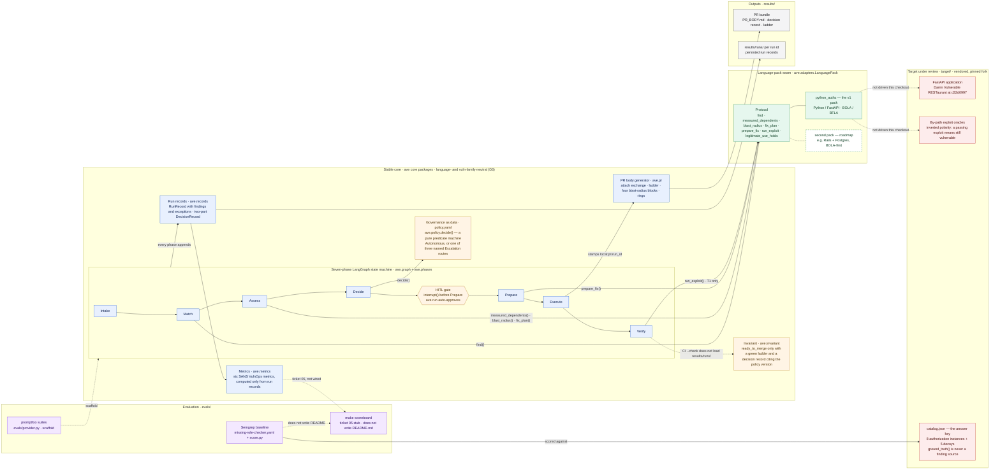
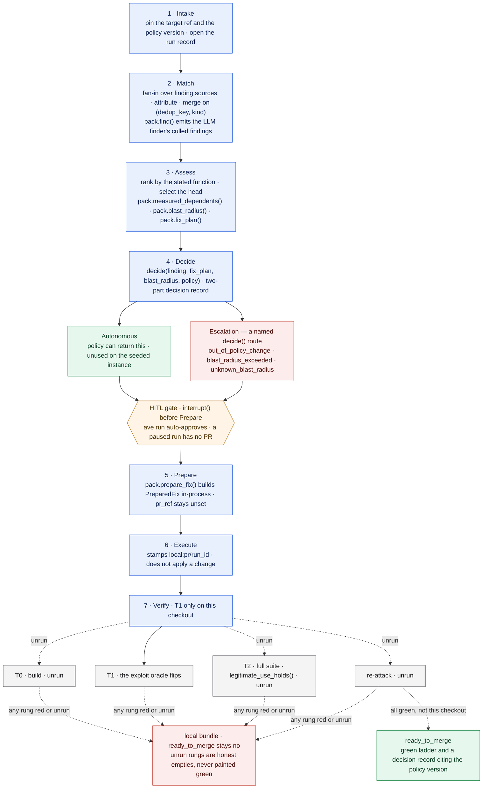

# AVE — Autonomous Vulnerability Eradication

> AVE reviews a codebase, finds vulnerabilities a pattern scanner structurally cannot
> see, and drives each one to a merged, test-verified, class-level fix — under a human
> governance gate. No fix is claimed, ever: every PR carries a decision record and a
> verification ladder in which the original exploit is re-run against the patched code.
> Every PR shows its reviewer the blast radius and deployment ring of the change. First
> proof: semantic authorization flaws (BOLA/BFLA) in a Python/FastAPI target, scored
> against a tuned Semgrep baseline.

AVE is a general-purpose vulnerability-eradication engine. Its first proof is **one deep
vertical** — semantic authorization flaws in a Python/FastAPI target — because depth is
what beats a pattern scanner. Multi-language support is on the roadmap, not in v1.

---

## Results

Scored against an oracle-bound instance catalog (native + seeded cases, plus decoys for
false positives). Every cell is generated from run records by `make scoreboard` — never
hand-entered. The table below is the **commitment the build must satisfy**; values fill in
as the loop runs.

| Case subset | Metric | Naive LLM | Semgrep (tuned) | AVE |
|-------------|--------|-----------|-----------------|-----|
| Semantic / ownership (BOLA) | Recall | _tbd_ | _tbd_ | _tbd_ |
| Semantic / ownership (BOLA) | Precision | _tbd_ | _tbd_ | _tbd_ |
| Role-pattern (BFLA) | Recall | _tbd_ | _tbd_ | _tbd_ |
| Overall | Precision | _tbd_ | _tbd_ | _tbd_ |
| True findings → fixed & ready | Fix rate | _tbd_ | 0 (by construction) | _tbd_ |

**What "beats Semgrep" means, stated honestly:** AVE strictly exceeds Semgrep **recall on
the semantic (ownership / BOLA) subset**, at **equal-or-better overall precision**, and
**additionally fixes** what it finds. Semgrep **ties or wins on pure role-pattern cases**
and costs nothing to run — this is stated, not hidden. There is no blanket "higher overall
F1" claim.

Six operational (SANS VulnOps) metrics render below the table, computed only from run
records.

---

## Non-goals

AVE is deliberately scoped. It does **not** attempt:

- **Multi-language support in v1** *(roadmap, not scope)* — the engine is architected for
  generality, but v1 ships a single Python/FastAPI vertical. A second language pack is
  future work.
- **General SAST** — AVE beats a pattern scanner on *semantic* cases; it does not replace
  broad static analysis.
- **Rollout execution** — deployment rings are designed and shown per PR, not run.
- **The identity plane** — AVE reasons about authorization in code, not IdP configuration.
- **Memory-safety classes** — out of the authorization-first vertical.
- **Agent-as-runtime** — AVE produces PRs; it is not a request-time control.
- **Auto-merge / self-approve** — a human governance gate is mandatory; AVE never merges
  its own change.

---

## From PR to production

**The PR is the product.** Every PR AVE opens is built to be reviewed in about two minutes:

- A generated **blast-radius view** — which callers and routes the change touches. The
  pack measures it in `find()` from an identity-aware AST call graph. A binding gap
  renders as `unmeasured`, never as a zero.
- The **deployment-ring** framing — what the change does in production, ring by ring.
- A two-part **decision record** citing the `policy.yaml` version that authorized the fix.
- A green **verification ladder** — T0 build, T1 the flipped exploit oracle, T2 the full
  suite, plus a re-attack of the original exploit against the patched code.

A draft PR may exist earlier so a human sees it at the `interrupt()` gate; it cannot become
ready-to-merge without the ladder and the decision record. This is the system's
**invariant**, enforced at a boundary — never by a prompt. See
[`docs/invariant.md`](./docs/invariant.md).

---

## Related work

- **SANS VulnOps Field Guide** — the operating frame / backbone for AVE's phases and its
  six operational metrics.
- **Prior-art harness & security-remediation triad patterns** — adopted *inside* the loop
  and cited, never used as the frame.

The target under review is a pinned fork of the Damn Vulnerable RESTaurant API Game by
theowni, used under GPL-3.0. See [`ATTRIBUTION.md`](./ATTRIBUTION.md).

---

## Architecture

AVE is a stable, language-neutral **core** with everything target-specific behind one
**language-pack seam**. The colours are boundaries: blue is the core, amber is governance
(policy, the HITL gate, the invariant), green is the seam and its packs, red is the target
under review, purple is evaluation, grey is what a run leaves behind. Solid edges are this
checkout. Dashed edges exist in code or on the roadmap and are not wired yet.



The **negative obligation** behind the green boundary: nothing in the core is named
`python`, `fastapi`, or `authz`, so a second pack is an adapter-plus-config change, not a
rewrite. The catalog's answer key is scored against, never read by a finder.

### One run through the loop



**Roadmap (D3):** harden the seam against a second pack, then a second vertical — a
Rails + Postgres target, BOLA-first, with a tenancy ownership model — through the unchanged
core. See [`docs/architecture.md`](./docs/architecture.md) for the phase table.

---

## Quick start

```bash
make setup       # install AVE + dev tooling
make check       # lint + strict typecheck + tests
make run         # walk seven phases on one seeded instance, write artifacts
make eradicate   # break then auto-approved run (HITL does not pause)
make scoreboard  # ticket 05 stub; does not edit README
```

See [Architecture](#architecture) above for the diagrams, [`docs/architecture.md`](./docs/architecture.md)
for the phase table, and [`Makefile`](./Makefile) for all verbs.

## License

GPL-3.0-or-later. See [`LICENSE`](./LICENSE) and [`ATTRIBUTION.md`](./ATTRIBUTION.md).
