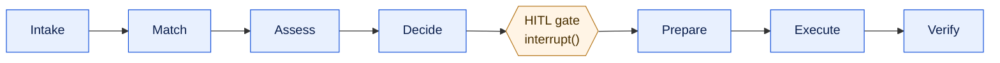

# Architecture

AVE is a LangGraph state machine of **seven phases**, with one human governance gate. The
README's [Architecture](../README.md#architecture) section carries the boundary map (core /
governance / seam / target / evaluation / outputs) and the one-run view; this page is the
phase table behind them.

| Phase | Responsibility | Seam call |
|-------|----------------|-----------|
| **Intake** | Pin the target ref + policy version; open the run record. | — |
| **Match** | Surface candidate findings (rule + model findings, fanned in behind the adapter seam) as neutral `Finding` records. | `find()` |
| **Assess** | Retrieve-then-reason over findings (avoids caller-graph context overflow); measure reach; select one to drive. | `blast_radius()` |
| **Decide** | Evaluate the proposed remediation against `policy.yaml` with the pure `decide()`; produce the two-part decision record citing the policy version. | `fix_plan()` |
| **HITL gate** | `interrupt()` before Prepare — a human reviews the decision record. Structural, never a prompt. | — |
| **Prepare** | Build the class-level change and a draft PR. | `prepare_fix()` |
| **Execute** | Apply the change; render the PR body (attack exchange, ladder, four blast-radius blocks, rings). | — |
| **Verify** | Run the verification ladder (T0 build, T1 flipped exploit oracle, T2 full suite + legitimate use, re-attack); only then mark ready-to-merge. | `run_exploit()`, `legitimate_use_holds()` |

## Stable core vs. the language-pack seam (D3)

The **core** — `ave.graph`, `ave.phases`, `ave.state`, `ave.records`, `ave.policy`,
`ave.invariant`, `ave.pr`, `ave.metrics`, `ave.telemetry` — is language- and
vuln-family-neutral. Nothing in it is named `python`, `fastapi`, or `authz`. Everything
target-specific plugs in behind [`ave.adapters`](../src/ave/adapters/README.md): the
`LanguagePack` protocol (finding sources, blast-radius extraction, a proposed fix plan, fix
templates, and an exploit-oracle harness with inverted polarity). v1's single pack is
`python_authz` (Python/FastAPI, BOLA/BFLA) against the vendored, pinned target in
[`target/`](../target/README.md). Adding a language is an adapter-plus-config change against
the unchanged core; the roadmap's second pack is a Rails + Postgres vertical, BOLA-first.

## Governance and the invariant

`policy.yaml` is governance as data. `ave.policy.decide()` is a pure predicate machine — no
clock, PR, or oracle inside, so CI can re-derive every decision — returning *Autonomous* or one
of four named *Escalation* routes. The invariant (`ave.invariant`): **no PR is ready-to-merge
without a green ladder and a decision record citing the policy version.** A draft PR may exist
earlier so a human sees it at the gate. See [`invariant.md`](./invariant.md).

## Compounding exports

1. **Run-record schema** (`ave.records.run_record`) — OTel-shaped; every phase appends; carries a
   per-finding lifecycle and an exceptions list so metrics, the invariant check, and monitoring
   read one record. See [`run-record-schema.md`](./run-record-schema.md).
2. **`policy.yaml` shape** (`ave.policy`) — governance-as-data.
3. **Language-pack seam** (`ave.adapters`) — the protocol a second language plugs into.
