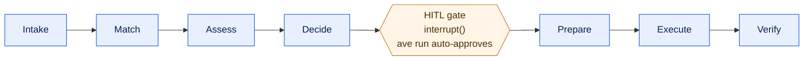

# Architecture

AVE is a LangGraph state machine of **seven phases**, with one human governance gate. The
README's [Architecture](../README.md#architecture) section carries the boundary map (core /
governance / seam / target / evaluation / outputs) and the one-run view; this page is the
phase table behind them. Solid edges on those diagrams are this checkout. Dashed edges
exist in code or on the roadmap and are not wired yet.

| Phase | Responsibility | Seam call |
|-------|----------------|-----------|
| **Intake** | Pin the target ref + policy version; open the run record. | — |
| **Match** | Fan-in over every finding source: attribute each `Finding` with its `source`, then merge findings from different sources that name the same flaw on `(dedup_key, kind)`, keeping both sources and the higher confidence (`ave.findings`). The pack's `find()` is still the only source; it emits the LLM finder's culled, citation-validated findings, and the fixture run ingests eight. | `find()`, `dedup_key()` |
| **Assess** | Rank the batch by the stated function (confidence desc → measured dependents asc → location asc), select the head to drive, record the rationale in state and in the span; project the reach the pack already measured in `find()`, propose a fix. One `measured_dependents()` mapping feeds both the ranking and the drivable selection, and the measured radius lands on the span. Every other ingested finding stays `open` in the run record. | `measured_dependents()`, `blast_radius()`, `fix_plan()` |
| **Decide** | Evaluate the proposed remediation against `policy.yaml` with the pure `decide()`; produce the two-part decision record citing the policy version. | — |
| **HITL gate** | `interrupt()` before Prepare. Structural, never a prompt. `ave run` auto-approves. A paused run has no `pr_ref`. | — |
| **Prepare** | `prepare_fix()` builds an in-process `PreparedFix`. A patch that touches different paths than the fix plan's `changed_paths` raises `PatchScopeMismatch` before Execute. `pr_ref` stays unset. | `prepare_fix()` |
| **Execute** | Stamp `local:pr/<run_id>`. Does not apply a change to the vendored app. `persist_run` writes the bundle after the graph. | — |
| **Verify** | T1 via `run_exploit()` only. T0, T2, and re-attack stay unrun. Does not call `legitimate_use_holds()`. `ready_to_merge` stays false. | `run_exploit()` |

## Stable core vs. the language-pack seam (D3)

The **core** — `ave.graph`, `ave.phases`, `ave.state`, `ave.records`, `ave.policy`,
`ave.invariant`, `ave.pr`, `ave.metrics`, `ave.telemetry` — is language- and
vuln-family-neutral. Nothing in it is named `python`, `fastapi`, or `authz`. Everything
target-specific plugs in behind [`ave.adapters`](../src/ave/adapters/README.md): the
`LanguagePack` protocol (finding sources, blast-radius extraction, a proposed fix plan, fix
templates, and an exploit-oracle harness with inverted polarity). v1's single pack is
`python_authz` (Python/FastAPI, BOLA/BFLA) against the vendored, pinned target in
[`target/`](../target/README.md). This checkout does not start that FastAPI app. The
pack's `CodeFactsStore` binds an identity-aware call graph
(`python_authz/callgraph.py`) over the allowlisted tree and answers
`reach_of(handler_id)`. `find()` measures every kept finding against that reach and
records the result under `evidence["blast_radius_measurement"]`, and a binding gap reads
as unmeasured (`None`), never as a zero. Adding a
language is an adapter-plus-config change against the unchanged core; the roadmap's second
pack is a Rails + Postgres vertical, BOLA-first.

## Governance and the invariant

`policy.yaml` is governance as data. `ave.policy.decide()` is a pure predicate machine.
It has no clock, PR, or oracle inside, so CI can re-derive every decision. It returns
*Autonomous* or one of three named *Escalation* routes (`unknown_blast_radius`,
`blast_radius_exceeded`, `out_of_policy_change`). `failed_stop_criterion` belongs to
`ring_stop_criterion()`, which this checkout does not enforce. The invariant
(`ave.invariant`): **`ready_to_merge` is true only with a green ladder and a decision
record citing the policy version.** That conjunction is in-graph.
`python -m ave.invariant --check` still prints
`invariant: OK (no run records to validate yet)` and does not load `results/runs/`.
`ave run` writes a local bundle under `results/runs/<id>/`, not a GitHub draft. See
[`invariant.md`](./invariant.md).

## Compounding exports

1. **Run-record schema** (`ave.records.run_record`). OTel-shaped. Every phase appends. It
   carries a per-finding lifecycle and an exceptions list. Metrics, the invariant check, and
   monitoring are meant to read that one record. `ave.metrics.compute_metrics` exists.
   `make scoreboard` does not call it. See [`run-record-schema.md`](./run-record-schema.md).
2. **`policy.yaml` shape** (`ave.policy`). Governance-as-data.
3. **Language-pack seam** (`ave.adapters`). The protocol a second language plugs into.
